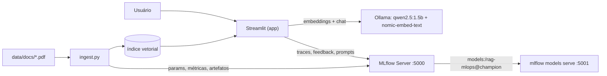

# 🤖 LLMOps com MLflow: assistente RAG da disciplina de MLOps

Projeto simples que mostra o **ciclo de LLMOps** usando as ferramentas de GenAI do **MLflow 3**.
Tudo roda **localmente com Docker**: o LLM fica no **Ollama** e não precisa de GPU nem de API paga.

O assistente responde perguntas sobre os PDFs da disciplina usando **RAG** (Retrieval-Augmented Generation).

## Arquitetura



## Ferramentas do MLflow utilizadas

| Etapa | Ferramenta do MLflow | Onde no código | O que demonstra |
|---|---|---|---|
| 1. Ingestão | **Experiment Tracking** | [ingest.py](src/ingest.py) | Parâmetros do RAG, métricas e índice versionado como artefato |
| 2. Prompt | **Prompt Registry** | [prompts.py](src/prompts.py) | Versionamento de prompt + alias `production` |
| 3. Execução | **Tracing** (autolog + `@mlflow.trace`) | [rag.py](src/rag.py) | Observabilidade: retrieval, prompt, chamada ao LLM, tokens e latência |
| 4. Uso | **Feedback humano** (`mlflow.log_feedback`) | [app.py](src/app.py) | 👍/👎 do usuário salvo dentro do trace |
| 5. Qualidade | **GenAI Evaluation** (`mlflow.genai.evaluate` + scorers) | [evaluate.py](src/evaluate.py) | Métricas heurísticas + LLM como juiz (local) |
| 6. Versionamento | **Models from Code + Model Registry** | [model.py](src/model.py), [register_model.py](src/register_model.py) | Pipeline empacotado, versionado, com alias `champion` |
| 7. Deploy | **Model Serving** (`mlflow models serve`) | `docker-compose.yml` (serviço `serve`) | API REST do modelo campeão |

## Como rodar

Pré-requisitos: Docker + Docker Compose. Na primeira vez são baixados cerca de 3,4 GB (imagem do Ollama) + 1,3 GB (modelos), e tudo fica em cache depois.

```bash
# 0. Coloque os PDFs da disciplina em data/docs/

make up         # sobe Ollama + MLflow + chat (e baixa os modelos)
make ingest     # 1. indexa os PDFs           -> run "ingestao" no MLflow
make prompt     # 2. registra o prompt         -> aba "Prompts"
                #    abra o chat em http://localhost:8501 e faça perguntas (traces + 👍/👎)
make eval       # 3. avalia com o eval_set     -> aba "Evaluations"
make register   # 4. registra o modelo         -> aba "Models"
make serve      # 5. sobe a API na porta 5001
```

> Depois de `make ingest`, rode `docker compose restart app` para o chat carregar o índice novo.

Teste da API servida:

```bash
curl -X POST http://localhost:5001/invocations \
  -H "Content-Type: application/json" \
  -d '{"inputs": ["O que é data drift?"]}'
```

Pergunta rápida pelo terminal: `make ask Q="O que é MLOps?"`

Para recomeçar do zero (apaga runs, traces, prompts e modelos do MLflow, mas mantém os modelos do Ollama): `make reset`.

> **Nota:** o Ollama em CPU trava com várias requisições simultâneas. Por isso a avaliação roda de forma sequencial (`MLFLOW_GENAI_EVAL_MAX_WORKERS=1` no `.env`) e o Ollama usa `OLLAMA_NUM_PARALLEL=1`.

**Endereços:**
- MLflow UI: http://localhost:5000 (experimento `rag-mlops`)
- Chat: http://localhost:8501
- API do modelo: http://localhost:5001

## Roteiro de demonstração (LLMOps)

1. **Tracking**: no run `ingestao`, mostrar os parâmetros (chunk_size, modelo de embedding), as métricas e o índice salvo como artefato.
2. **Tracing**: na aba *Traces*, abrir uma pergunta feita no chat e mostrar os spans `answer`, `retrieve` (com os chunks e scores) e a chamada ao LLM (prompt final, tokens, latência).
3. **Feedback**: dar 👎 em uma resposta e mostrar o feedback anexado ao trace.
4. **Prompt Registry**: editar o `TEMPLATE` em `src/prompts.py`, rodar `make prompt` e mostrar a versão 2 com o diff. O alias `production` passa a apontar para ela e o app usa o prompt novo **sem mudar código**.
5. **Evaluation**: rodar `make eval` e mostrar a tabela por pergunta, com notas e justificativas do juiz.
6. **Registry + Serving**: mostrar o modelo `rag-mlops` com o alias `champion` e chamar a API com `curl`.

## Personalização

- **Modelos**: edite o `.env` (`LLM_MODEL`, `EMBED_MODEL`) e rode `make up` de novo. Opções: `llama3.2:1b` (mais leve) ou `llama3.2:3b` / `qwen2.5:3b` (melhores, porém mais lentos).
- **Perguntas de avaliação**: edite `data/eval_set.json` com perguntas sobre os seus PDFs.
- **Parâmetros do RAG**: `CHUNK_SIZE`, `CHUNK_OVERLAP` e `TOP_K` no `.env`.

## Estrutura

```
├── docker-compose.yml    # ollama, mlflow, app (chat) e serve
├── Dockerfile / requirements.txt / .env / Makefile
├── data/
│   ├── docs/             # seus PDFs
│   ├── index/            # índice vetorial gerado (embeddings.npy + chunks.json)
│   └── eval_set.json     # perguntas de avaliação
└── src/
    ├── config.py         # configurações
    ├── llm.py            # cliente Ollama (API compatível com OpenAI)
    ├── ingest.py         # etapa 1 - ingestão + tracking
    ├── prompts.py        # etapa 2 - prompt registry
    ├── rag.py            # pipeline RAG com tracing
    ├── app.py            # chat Streamlit + feedback
    ├── evaluate.py       # etapa 3 - avaliação
    ├── model.py          # modelo pyfunc (models from code)
    └── register_model.py # etapa 4 - model registry
```
