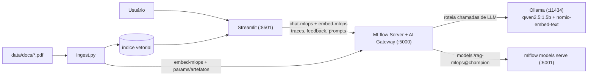

# 🤖 LLMOps com MLflow: assistente RAG da disciplina de MLOps

Projeto prático que demonstra o **ciclo completo de LLMOps** usando as ferramentas de GenAI do **MLflow 3**.
Tudo roda **100% localmente com Docker**: o LLM e o modelo de embeddings ficam no **Ollama** (em CPU, sem precisar de GPU nem de chave de API paga).

O sistema funciona como um assistente que responde perguntas sobre os slides da disciplina de MLOps usando **RAG** (*Retrieval-Augmented Generation*).

---

## 📚 Materiais da disciplina (`data/docs/`)

Por questões de direitos autorais do professor, os PDFs das aulas e o índice vetorial gerado **não são versionados no Git** (estão listados no `.gitignore`).

Antes de rodar a ingestão e a avaliação, copie os seguintes slides da disciplina para dentro da pasta `data/docs/` (com esses nomes exatos, pois o arquivo `data/eval_set.json` valida a fonte e a página recuperada):

1. `data/docs/2 - Introdução a Engenharia de Dados.pdf` *(Aula 2 — Fontes, Formatos, Armazenamento e Processamento de Dados)*
2. `data/docs/4 - Engenharia de Features.pdf` *(Aula 4 — Modelagem, Extração, Transformação, Seleção e Armazenamento de Features)*

### Como adicionar mais slides depois?
Você pode colocar qualquer outro `.pdf`, `.md` ou `.txt` da matéria dentro de `data/docs/`. Sempre que adicionar novos arquivos:
```bash
make ingest                    # reindexa todos os documentos de data/docs/
docker compose restart app     # recarrega o índice atualizado no chat Streamlit
make eval                      # (opcional) roda a avaliação se tiver adicionado perguntas no data/eval_set.json
make register                  # (opcional) cria uma nova versão do modelo com o índice atualizado
```

---

## 🏛️ Arquitetura



- **Ollama (`:11434`):** hospeda os pesos brutos do LLM (`qwen2.5:1.5b`) e do modelo de embeddings (`nomic-embed-text`).
- **MLflow Server + AI Gateway (`:5000`):** centraliza o *AI Gateway* (que recebe todas as chamadas de LLM nos endpoints lógicos `chat-mlops` e `embed-mlops` e roteia para o Ollama), além do *Experiment Tracking*, *Prompt Registry*, *Traces*, *Feedback humano*, *Evaluations* e *Model Registry*.
- **Streamlit (`:8501`):** interface de chat que busca o prompt ativo no MLflow, chama o **MLflow AI Gateway** para embeddings e chat, e grava os traces e avaliações (👍/👎) no MLflow.
- **Model Serving (`:5001`):** serve o pipeline RAG completo empacotado no Model Registry (`models:/rag-mlops@champion`) como uma API REST (`/invocations`).

---

## 🛠️ Ferramentas do MLflow utilizadas

| Etapa | Ferramenta do MLflow | Onde no código | O que demonstra em LLMOps |
|---|---|---|---|
| 0. Roteamento | **AI Gateway** | [gateway.py](src/gateway.py), [llm.py](src/llm.py) | Proxy centralizado com endpoints lógicos (`chat-mlops`, `embed-mlops`), gestão de credenciais, *usage tracking* e desacoplamento do provedor |
| 1. Ingestão | **Experiment Tracking** | [ingest.py](src/ingest.py) | Parâmetros do RAG (`chunk_size`, `overlap`, modelo de embedding), métricas e índice salvo como artefato |
| 2. Prompt | **Prompt Registry** | [prompts.py](src/prompts.py) | Versionamento de prompt (`v1`, `v2`...) + alias `production` desacoplado do código |
| 3. Execução | **Tracing** (`autolog` + `@mlflow.trace`) | [rag.py](src/rag.py) | Observabilidade por *spans*: busca vetorial (chunks e scores), prompt formatado, tokens e latência |
| 4. Uso | **Feedback / Assessments** (`mlflow.log_feedback`) | [app.py](src/app.py) | Botões 👍/👎 do usuário gravados diretamente no trace da resposta |
| 5. Qualidade | **GenAI Evaluation** (`mlflow.genai.evaluate` + `@scorer`) | [evaluate.py](src/evaluate.py) | 12 casos de teste avaliando retrieval (`recuperou_fonte`), anti-alucinação (`comportamento_esperado`), palavras-chave e **LLM-as-a-Judge** local (`juiz_llm`) |
| 6. Versionamento | **Models from Code + Model Registry** | [model.py](src/model.py), [register_model.py](src/register_model.py) | Pipeline RAG + índice vetorial empacotados como modelo `pyfunc` versionado com alias `champion` |
| 7. Deploy | **Model Serving** (`mlflow models serve`) | `docker-compose.yml` (serviço `serve`) | Deploy padronizado do modelo `champion` como API REST |

---

## 🚀 Como rodar passo a passo

**Pré-requisitos:** Docker, Docker Compose e `make`.
*(Na primeira execução são baixados ~3,4 GB da imagem do Ollama + ~1,3 GB dos modelos, que ficam salvos em volume Docker para as próximas execuções).*

### 1. Coloque os slides na pasta `data/docs/`
Copie os dois PDFs listados na seção [Materiais da disciplina](#-materiais-da-disciplina-datadocs) para `data/docs/`.

### 2. Suba a infraestrutura, baixe os modelos e configure o AI Gateway
```bash
make up                      # sobe Ollama + MLflow, baixa os modelos, roda src.gateway e sobe o Streamlit
```
*(Se quiser apenas reconfigurar os endpoints do AI Gateway depois de mudar o `.env`, rode `make gateway`).*

### 3. Execute o pipeline de LLMOps
```bash
make ingest                  # Etapa 1: extrai texto dos PDFs, gera embeddings e loga o run "ingestao"
make prompt                  # Etapa 2: registra o template de prompt com alias "production"
docker compose restart app   # Recarrega o chat Streamlit com o índice recém-criado
```

Neste ponto você já pode usar o chat e inspecionar o MLflow:
- **Chat Streamlit:** http://localhost:8501 *(faça perguntas e clique em 👍 ou 👎 para ver o feedback no trace)*
- **MLflow UI:** http://localhost:5000 *(experimento `rag-mlops`)*

### 4. Rode a avaliação automatizada e registre o modelo
```bash
make eval                    # Etapa 3: avalia as 12 perguntas do data/eval_set.json (~2 a 3 min em CPU)
make register                # Etapa 4: empacota e registra o modelo "rag-mlops" com alias "champion"
```

### 5. (Opcional) Suba e teste a API REST do modelo registrado
```bash
make serve                   # Etapa 5: sobe o container "serve" na porta 5001
```
Teste a API servida pelo MLflow:
```bash
curl -X POST http://localhost:5001/invocations \
  -H "Content-Type: application/json" \
  -d '{"inputs": ["Qual a diferença entre OLTP e OLAP?"]}'
```

### Outros comandos úteis
- Pergunta rápida via terminal: `make ask Q="O que é um Feature Store?"`
- Parar os containers: `make down`
- Limpar banco/runs do MLflow e índice (mantendo os modelos do Ollama): `make reset`

> **Nota sobre CPU:** o Ollama em CPU processa uma requisição por vez (`OLLAMA_NUM_PARALLEL=1`), e a avaliação roda com 1 worker (`MLFLOW_GENAI_EVAL_MAX_WORKERS=1` no `.env`) para evitar timeouts de concorrência.

---

## 🎤 Roteiro de demonstração (apresentação)

0. **AI Gateway:** abrir a aba **AI Gateway** no menu lateral do MLflow (`http://localhost:5000/#/gateway`) e mostrar os endpoints `chat-mlops` e `embed-mlops`, as *Model Definitions* apontando para o Ollama, o *Secret* `ollama-local` criptografado e os gráficos de **Usage** (contagem de requisições, latência e tokens que passaram pelo Gateway).
1. **Tracking (`ingestao`):** no experimento `rag-mlops`, abrir o run `ingestao` e mostrar os parâmetros (`chunk_size`, `embed_model`), métricas (`num_paginas=51`, `num_chunks=50`) e o artefato `index/`.
2. **Tracing:** na aba **Traces**, abrir uma pergunta feita no Streamlit e expandir a árvore `answer` → `retrieve` (mostrando os 4 slides recuperados com seus scores) → `Embeddings` → `Completions` (prompt montado, tokens e tempo).
3. **Feedback humano:** clicar em 👍 ou 👎 no Streamlit e atualizar o trace no MLflow para mostrar o `feedback_usuario` anexado.
4. **Prompt Registry:** na aba **Prompts**, mostrar o `rag-mlops-prompt` com o alias `production`. Se editar `TEMPLATE` em `src/prompts.py` e rodar `make prompt`, o MLflow cria a `v2` com comparador de *diff* e atualiza o app sem mexer no código do RAG.
5. **Evaluation:** na aba **Evaluations**, mostrar o resultado das 12 perguntas com `recuperou_fonte`, `comportamento_esperado` (incluindo a recusa na pergunta fora do material sobre *backpropagation*), `cobertura_palavras_chave` e a justificativa do `juiz_llm`.
6. **Model Registry & Serving:** na aba **Models**, mostrar o modelo `rag-mlops` versão 1 com alias `champion` e fazer a chamada via `curl` na porta `5001`.

---

## 📁 Estrutura do projeto

```
├── docker-compose.yml    # Serviços: ollama, ollama-pull, mlflow, app (Streamlit) e serve
├── Dockerfile / requirements.txt / .env / Makefile
├── data/
│   ├── docs/             # PDFs da disciplina (ignorados no Git)
│   ├── index/            # Índice vetorial gerado: embeddings.npy + chunks.json (ignorado no Git)
│   └── eval_set.json     # 12 perguntas e gabaritos baseados nas Aulas 2 e 4
└── src/
    ├── config.py         # Configurações centrais e conexão com o MLflow
    ├── gateway.py        # Etapa 0 - Configuração dos endpoints no MLflow AI Gateway
    ├── llm.py            # Cliente de LLM/Embeddings apontando para o MLflow AI Gateway
    ├── ingest.py         # Etapa 1 - Ingestão dos PDFs + Experiment Tracking
    ├── prompts.py        # Etapa 2 - Registro e versionamento no Prompt Registry
    ├── rag.py            # Pipeline RAG instrumentado com MLflow Tracing
    ├── app.py            # Interface de chat (Streamlit) + coleta de Feedback humano
    ├── evaluate.py       # Etapa 3 - Avaliação com mlflow.genai.evaluate e Scorers
    ├── model.py          # Definição PyFunc ("Models from Code")
    └── register_model.py # Etapa 4 - Registro no Model Registry com alias "champion"
```
